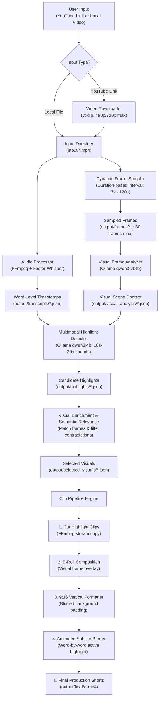

# 🎬 LocalVideoAI — Local AI Video Clipping & Shorts Generator

> **100% Local, Offline-Capable AI Pipeline** that transforms long-form videos or YouTube links into engaging **9:16 vertical shorts (10–20s)** with **B-roll composition** and **word-synced animated subtitles**, powered entirely by local models (**Faster-Whisper** + **Ollama**).

---

## 🌟 Overview

**LocalVideoAI** is an end-to-end automated pipeline designed to create high-retention short-form video clips (YouTube Shorts, TikTok, Instagram Reels) from long-form content. 

Unlike cloud-dependent SaaS solutions, LocalVideoAI runs **completely on your local machine**:
- **No API keys or cloud bills**: Powered by local Ollama models (`qwen3:4b` and `qwen3-vl:4b`) and local Faster-Whisper.
- **YouTube Ingestion**: Download directly from YouTube with automatic quality capping (480p / 720p).
- **Intelligent 10–20s Highlights**: AI grounds speech into complete, standalone thoughts without cutting sentences mid-clause.
- **Dynamic Frame Interval**: Automatically scales frame sampling intervals based on video duration so local vision analysis stays fast without choking hardware.
- **Visual B-Roll Integration**: Matches spoken moments with relevant visual shots and composes smooth B-roll cutaways.
- **Animated Karaoke Subtitles**: Frame-by-frame word-level highlighted subtitles with automatic CJK/Japanese/Unicode font support.

---

## 🏗️ Architecture & Pipeline Flow



---

## ⚡ Key Features & Engineering

### 1. YouTube Downloader & Quality Selection
- Download any YouTube URL or YouTube Short directly into `input/`.
- Interactive prompt asks for video quality (**480p** or **720p**, capped at 720p max for fast processing).
- Automatically sanitizes titles to prevent filesystem and shell character encoding errors.

### 2. Scalable Dynamic Frame Sampling
Vision model inference on local hardware can bottleneck if too many frames are extracted. The pipeline dynamically adjusts frame sampling to keep total analyzed frames at **~25–30 frames max**:
- **≤ 1 min video**: 3s interval (~20 frames)
- **3 mins video**: 6s interval (~30 frames)
- **5 mins video**: 10s interval (~30 frames)
- **10 mins video**: 20s interval (~30 frames)
- **15 mins video**: 30s interval (~30 frames)
- **20–30 mins video**: 45s–60s interval (~26–30 frames)
- **> 30 mins video**: Automatically scales up to 120s interval

### 3. Strict 10–20 Second Highlight Grounding
- Prompts instruct `qwen3:4b` to strictly identify moments between **10.0s and 20.0s**.
- Automated boundary refinement expands short clips across sentence boundaries and trims dangling prepositions or conjunctions (e.g., *"and"*, *"because"*, *"from"*).
- Repetition suppression filters out Whisper noise hallucination loops (e.g. repetitive background chanting).

### 4. Word-by-Word Animated Subtitles
- Uses high-speed Pillow frame generation + FFmpeg overlay.
- Active word highlighting with subtle scale bounce and outline drop-shadow.
- Multi-lingual font fallback: automatically detects CJK/Japanese characters and loads system fonts (`Yu Gothic Bold`, `MS Gothic`, `Meiryo`) to prevent missing glyphs or boxes.

### 5. Windows & Local Hardware Hardening
- Reconfigured standard I/O streams with UTF-8 encoding and `errors="replace"` to eliminate `UnicodeEncodeError: 'charmap'` crashes on Windows.
- Increased local Ollama timeout to **600 seconds** (10 minutes) with optimized context cache (`num_ctx=8192`) to prevent timeout aborts on 15+ minute videos.

---

## 🧰 Tech Stack

| Component | Technology | Purpose |
|---|---|---|
| **Language** | Python 3.10+ | Core application runtime |
| **Speech-to-Text** | [Faster-Whisper](https://github.com/SYSTRAN/faster-whisper) (CTranslate2) | Fast local audio extraction & word-level timestamping |
| **Local LLM** | [Ollama](https://ollama.com/) — `qwen3:4b` | Highlight identification, semantic grounding, and reasoning |
| **Vision Model** | [Ollama](https://ollama.com/) — `qwen3-vl:4b` | Frame visual interest scoring, scene description, and B-roll relevance |
| **Video Engine** | [FFmpeg](https://ffmpeg.org/) & FFprobe | Stream cutting, 9:16 aspect ratio formatting, audio-video muxing |
| **Subtitles** | Pillow (PIL) | Sub-second word-by-word animated overlay rendering |
| **Video Ingestion** | [yt-dlp](https://github.com/yt-dlp/yt-dlp) | YouTube video downloading with format selection |

---

## 📁 Directory Structure

```text
LocalVideoAI/
├── app/
│   └── core/
│       ├── animated_subtitle_renderer.py   # Word-synced animated subtitle renderer
│       ├── audio_processor.py              # Audio extraction & Faster-Whisper transcription
│       ├── broll_composer.py               # B-roll cutaway overlay composer
│       ├── clip_generator.py               # Sub-clip extraction via FFmpeg
│       ├── clip_pipeline.py                # Formatting, B-roll, and subtitle pipeline
│       ├── frame_analyzer.py               # Vision analysis via Ollama qwen3-vl:4b
│       ├── frame_sampler.py                # Dynamic duration-based frame extraction
│       ├── full_pipeline.py                # End-to-end master pipeline coordinator
│       ├── highlight_detector.py           # 10-20s AI highlight detector & grounder
│       ├── llm_client.py                   # Local Ollama HTTP JSON client (with 600s timeout)
│       ├── subtitle_burner.py              # Standard SRT subtitle burner
│       ├── subtitle_generator.py           # SRT and JSON subtitle generator
│       ├── video_downloader.py             # yt-dlp YouTube video downloader (480p/720p)
│       ├── video_formatter.py              # 9:16 vertical crop & blurred padding
│       ├── video_processor.py              # Video probe and metadata helpers
│       ├── vision_client.py                # Base64 Ollama Vision client
│       ├── visual_enricher.py              # Maps visual frames to highlight moments
│       ├── visual_relevance.py             # Evaluates visual topic/context match
│       └── visual_selector.py              # Selects optimal diverse frames for B-roll
├── input/                                  # Downloaded & source videos
├── logs/                                   # Full pipeline run logs
├── output/
│   ├── audio/                              # Extracted 16kHz WAV audio files
│   ├── broll/                              # Composed B-roll video segments
│   ├── clips/                              # Raw cut highlight segments
│   ├── enriched/                           # Enriched highlight metadata JSONs
│   ├── final/                              # Final 9:16 vertical shorts with subtitles
│   ├── formatted/                          # 9:16 vertical formatted clips (pre-subtitle)
│   ├── frames/                             # Extracted representative video frames
│   ├── highlights/                         # Detected AI highlight JSONs
│   ├── pipeline_results/                   # Detailed pipeline execution reports
│   ├── selected_visuals/                   # Filtered visual frames for B-roll
│   ├── subtitles/                          # Generated SRT/JSON captions & temp frames
│   └── visual_analysis/                    # Vision model scene analysis JSONs
├── main.py                                 # Primary user-facing entry point
├── requirements.txt                        # Python dependencies
└── README.md
```

---

## 🚀 Setup & Installation Guide

### Prerequisites
1. **Python 3.10 – 3.13** installed on your system.
2. **FFmpeg & FFprobe** installed and added to your system `PATH`:
   ```powershell
   ffmpeg -version
   ffprobe -version
   ```
3. **Ollama** installed and running locally:
   ```powershell
   ollama --version
   ```
   Pull the required local models:
   ```powershell
   ollama pull qwen3:4b
   ollama pull qwen3-vl:4b
   ```

---

### Step 1: Clone the Repository & Create Virtual Environment
```powershell
# Navigate to project directory
cd "LocalVideoAI"

# Create a virtual environment
python -m venv .venv

# Activate virtual environment (Windows PowerShell)
.\.venv\Scripts\Activate.ps1
```

---

### Step 2: Install Dependencies
```powershell
pip install -r requirements.txt
```

---

## 🎮 How to Run

### Method 1: Interactive Mode (Recommended)
Simply launch `main.py`:
```powershell
.\.venv\Scripts\python.exe main.py
```
You will be prompted:
```text
=================================================================
LOCAL AI VIDEO CLIPPING - YOUTUBE INPUT
=================================================================
Enter YouTube video link (or local video path): https://www.youtube.com/watch?v=YOUR_VIDEO

Select video quality (max 720p):
  [1] 720p (Recommended)
  [2] 480p
Choice [1/2, default: 1]: 1
```
The application will download the video and automatically proceed through the entire pipeline.

---

### Method 2: Command Line (One-Liner)

#### Download & Process from YouTube:
```powershell
.\.venv\Scripts\python.exe main.py "https://www.youtube.com/watch?v=YOUR_VIDEO" --quality 720p --min-duration 10 --max-duration 20 --subtitle-mode animated
```

#### Process an Existing Local Video:
```powershell
.\.venv\Scripts\python.exe main.py input\my_video.mp4 --min-duration 10 --max-duration 20 --subtitle-mode animated
```

#### Command-Line Arguments:
- `video`: Optional positional argument (YouTube URL or path to local file).
- `--url`: YouTube URL to download.
- `--quality`: Download quality: `720p` (default) or `480p`.
- `--interval`: Sampling interval in seconds (`0` for auto-calculation based on video length).
- `--min-duration`: Minimum clip length in seconds (default: `10.0`).
- `--max-duration`: Maximum clip length in seconds (default: `20.0`).
- `--subtitle-mode`: Subtitle style: `animated` (default) or `standard` (static SRT).

---

### Method 3: Step-by-Step Manual Execution

If you wish to execute each stage individually:

```powershell
# 1. Download YouTube video
.\.venv\Scripts\python.exe app\core\video_downloader.py "https://www.youtube.com/watch?v=YOUR_VIDEO" --quality 720p

# 2. Audio extraction and speech transcription
.\.venv\Scripts\python.exe app\core\audio_processor.py input\my_video.mp4

# 3. Dynamic frame extraction
.\.venv\Scripts\python.exe app\core\frame_sampler.py input\my_video.mp4 --interval 0

# 4. Vision analysis with Ollama
.\.venv\Scripts\python.exe app\core\frame_analyzer.py output\frames\my_video --interval 0

# 5. AI highlight detection (10-20s duration)
.\.venv\Scripts\python.exe app\core\highlight_detector.py output\transcripts\my_video.json --visual output\visual_analysis\my_video_visual_analysis.json --min-duration 10 --max-duration 20

# 6. Visual enrichment and semantic relevance
.\.venv\Scripts\python.exe app\core\visual_enricher.py output\highlights\my_video_highlights.json output\visual_analysis\my_video_visual_analysis.json
.\.venv\Scripts\python.exe app\core\visual_selector.py output\enriched\my_video_enriched.json

# 7. Final vertical clip formatting & animated subtitle burn
.\.venv\Scripts\python.exe app\core\clip_pipeline.py input\my_video.mp4 output\transcripts\my_video.json output\selected_visuals\my_video_selected_visuals.json --subtitle-mode animated
```

---

## 📤 Output Artifacts

All final vertical shorts with animated subtitles are placed in:
```text
output/final/<video_name>/
  ├── 01_Title_of_Highlight_final.mp4
  ├── 02_Title_of_Highlight_final.mp4
  └── ...
```

---

## 📄 License
This project is for educational and personal use. Content creators are responsible for adhering to YouTube's Terms of Service and respecting copyrights of source media.
